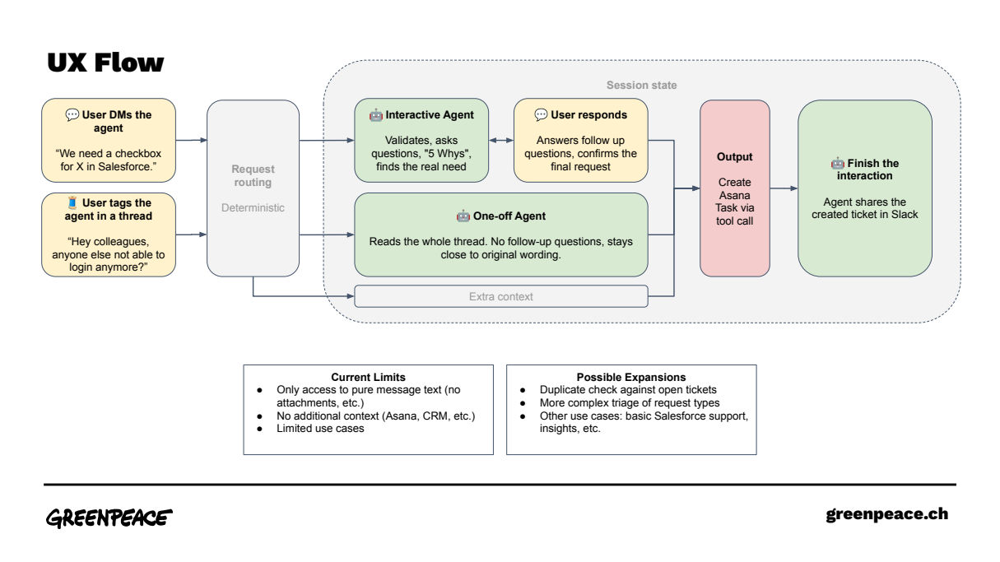
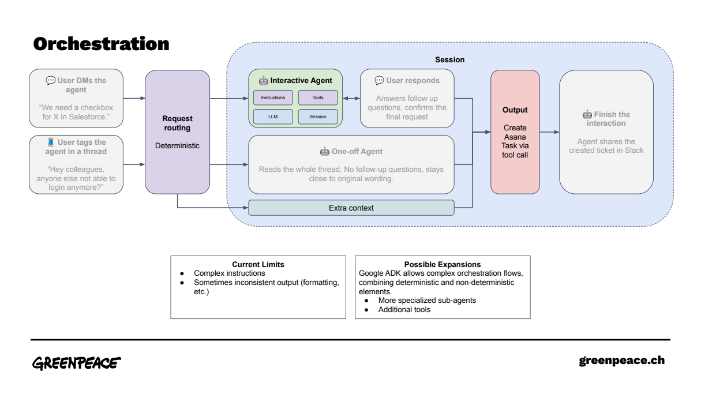
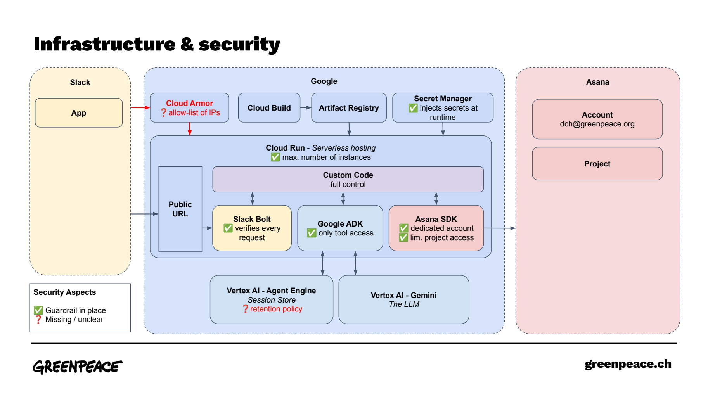

# DaESy Helper Bot

## Purpose

An AI agent that interacts with users via Slack and helps them with DaESy tasks.

**Current functionality:**

* Writes Asana tickets based on 1:1 conversations with the bot or from thread context if the bot is tagged in a message thread.



## Architecture

The agent consists of the following components:

* **Interfaces & Integrations:** Slack App (User Client), Asana (Output)

* **Agent Orchestrator:** Python App (Google ADK, Slack Bolt), built and hosted in Google Cloud (`cloudbuild`, `artifactregistry`, `run`)

* **Intelligence Base:** Gemini via Vertex AI API

* **State Management:** Vertex AI Session Service



## Prerequisites

Before setting up the project, ensure you have the following installed:

* [Task](https://taskfile.dev/installation/) for helpful shortcuts

* [uv](https://docs.astral.sh/uv/getting-started/installation/) for Python dependency management

* [Google Cloud CLI](https://cloud.google.com/sdk/docs/install)

* [ngrok](https://ngrok.com/download) (ensure you authenticate with `ngrok config add-authtoken <YOUR_TOKEN>`)

## Local Development Setup

1. **Clone the repository:**

   ```bash
   git clone <repository-url>
   cd daesy-helper-bot
   ```

2. **Install dependencies:**

   ```bash
   uv sync
   ```

3. **Environment Configuration:**
   Create an `.env` file based on `.env.example`. You will need to complete it with secrets for your Slack App, Asana Project, and GCP environment. 

4. **Google Cloud Authentication:**
   Authenticate your local machine to interact with Vertex AI:

   ```bash
   gcloud auth application-default login
   ```

5. **Run the App Locally:**
   Start the daesy_helper orchestrator:

   ```bash
   task dev:local
   ```

6. **Expose Localhost via ngrok:**
   In a separate terminal, start the tunnel:

   ```bash
   task dev:tunnel
   ```

   *Note: Once ngrok is running, copy the generated HTTPS URL and paste it into your Slack App's "Event Subscriptions" webhook configuration (e.g., `https://<your-ngrok-url>.ngrok-free.app/slack/events`).*

> **Optional: Local Development without Vertex AI**
> If you prefer, you can switch to `InMemorySessionService()` and use the free tier models in Google AI Studio for local development.
>
> * In `main.py`, adjust the session service code.
>
> * In your `.env` file, set `GEMINI_API_KEY=[your_key]` and `GOOGLE_GENAI_USE_VERTEXAI=FALSE`.

## Slack App Setup

1. Use the manifest file located at `daesy_helper_bot/slack/manifest.yaml` to configure your Slack app in the Slack API dashboard. Don't forget to replace the placeholder with your webhook url (either local ngrok or Google Cloud Run).

2. Update your `.env` file with the relevant Slack IDs generated after app creation.

## Google Cloud Deployment

1. Create the agent engine using the provided script and update your `.env` file with the resulting engine ID:

   ```bash
   python scripts/create_agent_engine.py
   ```

2. Enable required APIs, create Service Accounts, and set up permissions:

   ```bash
   task setup:all
   ```

3. Compile and deploy the application to Cloud Run:

   ```bash
   task ship:all
   ```

*For more fine-grained operational tasks, inspect the `Taskfile.yml`.*

## Security Considerations

Because the connection to Slack is handled via Webhooks, the Cloud Run URL must be publicly accessible (using the `--allow-unauthenticated` flag). This introduces a potential security risk.

**Mitigation Measures:**

* **Request Verification:** All incoming requests are handled by Slack Bolt's `AsyncApp` and strictly verified using the `SLACK_SIGNING_SECRET`.

* **Cost Control:** While DDOS attacks can cause service interruptions, cost spikes are heavily limited by setting `--max-instances=2` on the Cloud Run service.

* **IP Allowlisting (Optional):** You can configure a Web Application Firewall (e.g., Google Cloud Armor) to only allow incoming requests from known Slack IP addresses.

